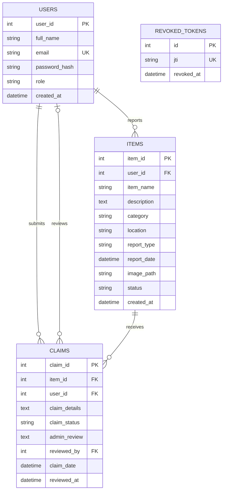

# Campus Lost and Found Management System
## Database Schema and Entity Relationship Diagram

### 1. Introduction

The Campus Lost and Found Management System uses a relational SQLite database to manage student accounts, lost and found item reports, ownership claims, and authentication token revocation.

The database consists of four main tables:

1. USERS
2. ITEMS
3. CLAIMS
4. REVOKED_TOKENS

The database schema is designed using primary keys and foreign keys to maintain relationships and data consistency between related records.

---

### 2. Entity Relationship Diagram (ERD)

The following Mermaid ER diagram represents the database structure and relationships.

---

### 3. Database Tables Description

#### 3.1 USERS Table

The USERS table stores the details of registered students and administrators.

| Attribute | Data Type | Constraint | Description |
|---|---|---|---|
| user_id | Integer | Primary Key | Unique user identifier |
| full_name | VARCHAR(100) | NOT NULL | Full name of the user |
| email | VARCHAR(150) | UNIQUE, NOT NULL | User email address |
| password_hash | VARCHAR(255) | NOT NULL | Hashed user password |
| role | VARCHAR(20) | NOT NULL | User role (student/admin) |
| created_at | DATETIME | Default Current Timestamp | Account creation time |

#### 3.2 ITEMS Table

The ITEMS table stores all lost and found item reports submitted by users.

| Attribute | Data Type | Constraint | Description |
|---|---|---|---|
| item_id | Integer | Primary Key | Unique item identifier |
| user_id | Integer | Foreign Key | User who reported the item |
| item_name | VARCHAR(150) | NOT NULL | Name of the item |
| description | TEXT | NOT NULL | Item description |
| category | VARCHAR(100) | NOT NULL | Item category |
| location | VARCHAR(200) | NOT NULL | Location associated with the item |
| report_type | VARCHAR(20) | NOT NULL | Lost or Found |
| report_date | DATETIME | NOT NULL | Date of loss or discovery |
| image_path | VARCHAR(500) | Nullable | Stored image path |
| status | VARCHAR(30) | NOT NULL | Item status |
| created_at | DATETIME | Default Current Timestamp | Record creation time |

#### 3.3 CLAIMS Table

The CLAIMS table stores ownership claims submitted by students for found items and the corresponding administrative review information.

| Attribute | Data Type | Constraint | Description |
|---|---|---|---|
| claim_id | Integer | Primary Key | Unique claim identifier |
| item_id | Integer | Foreign Key | Associated found item |
| user_id | Integer | Foreign Key | Student submitting the claim |
| claim_details | TEXT | NOT NULL | Ownership explanation |
| claim_status | VARCHAR(20) | NOT NULL | Pending, approved or rejected |
| admin_review | TEXT | Nullable | Administrator's review remarks |
| reviewed_by | Integer | Foreign Key, Nullable | Administrator who reviewed the claim |
| claim_date | DATETIME | Default Current Timestamp | Claim submission time |
| reviewed_at | DATETIME | Nullable | Claim review time |

#### 3.4 REVOKED_TOKENS Table

The REVOKED_TOKENS table stores identifiers of authentication tokens that have been revoked, helping prevent their reuse after logout.

| Attribute | Data Type | Constraint | Description |
|---|---|---|---|
| id | Integer | Primary Key | Unique record identifier |
| jti | VARCHAR(255) | UNIQUE, NOT NULL | JWT token identifier |
| revoked_at | DATETIME | Default Current Timestamp | Token revocation time |

---

### 4. Database Relationships

The database contains the following relationships:

**1. USERS – ITEMS (One-to-Many)**

A single user can report multiple lost or found items. Each item report is associated with one user.

**2. USERS – CLAIMS (One-to-Many)**

A user can submit multiple ownership claims. Each claim is submitted by one user.

**3. ITEMS – CLAIMS (One-to-Many)**

A found item can receive multiple ownership claims from different users. Each claim belongs to one item.

**4. USERS – CLAIMS (Administrator Review)**

An administrator can review multiple claims. The reviewed_by attribute identifies the administrator responsible for a review. This field can remain empty until a claim is reviewed.

**5. REVOKED_TOKENS**

The revoked token records are maintained separately. The current implementation does not define a direct foreign-key relationship between this table and USERS.

---

### 5. Primary Keys and Foreign Keys

| Table | Primary Key | Foreign Keys |
|---|---|---|
| USERS | user_id | None |
| ITEMS | item_id | user_id |
| CLAIMS | claim_id | item_id, user_id, reviewed_by |
| REVOKED_TOKENS | id | None |

Primary keys uniquely identify each record, while foreign keys establish relationships between related tables.

---

### 6. Database Design Summary

The Campus Lost and Found Management System uses a relational database structure consisting of four tables. The USERS table manages account information, the ITEMS table stores lost and found reports, the CLAIMS table handles ownership verification and administrative decisions, and the REVOKED_TOKENS table supports authentication security.

The database design provides a structured foundation for user management, item reporting, claim processing, and secure authentication.

---

### 7. Technology Used

- Database: SQLite
- ORM: SQLAlchemy
- Backend Framework: FastAPI
- Schema Design: Mermaid ER Diagram
- Primary Keys and Foreign Keys: Relational database constraints
