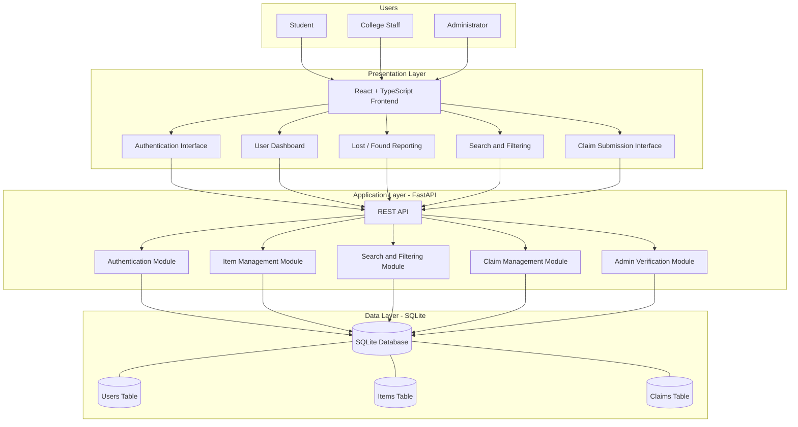

# System Architecture Diagram
## Campus Lost and Found Management System

### 1. Architecture Overview

The Campus Lost and Found Management System follows a three-tier
architecture consisting of the Presentation Layer, Application Layer
and Data Layer.

### 2. Architecture Diagram

### 3. Technology Stack

| Layer | Technology | Purpose |
|---|---|---|
| Presentation | React.js | User interface |
| Programming | TypeScript | Frontend type safety |
| Application | Python | Backend programming |
| Backend Framework | FastAPI | REST API development |
| Database | SQLite | Persistent data storage |
| Version Control | Git and GitHub | Source code management |
| Project Management | Jira | Task tracking and collaboration |

### 4. System Deployment

The frontend and backend are developed as separate applications.

- Frontend: React application served through a development or production web server.
- Backend: FastAPI application served using Uvicorn.
- Database: SQLite database accessed by the backend.
- Communication: Frontend communicates with the backend through HTTP-based REST APIs.

For the initial prototype, the frontend and backend can run locally
on the development machine.

### 5. Scalability Considerations

- The frontend and backend are separated, allowing independent updates.
- FastAPI supports handling multiple API requests.
- The database can be migrated to PostgreSQL if the application grows.
- Additional backend instances can be introduced if deployment demand increases.

### 6. Potential Bottlenecks

- SQLite may become a bottleneck with many simultaneous write operations.
- Large image uploads may increase storage and response time.
- Inefficient search queries may affect performance as item records grow.
- A single backend instance may limit request-handling capacity.

### 7. Conclusion

The proposed three-tier architecture provides separation between
the user interface, application logic and data storage. This makes
the system easier to maintain, test and extend in future versions.
