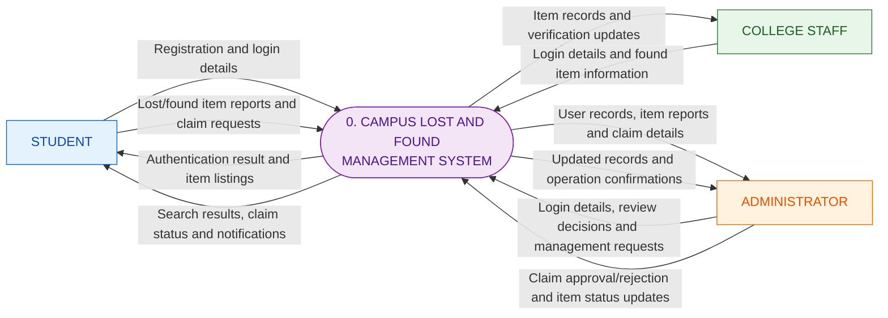

# Data Flow Diagram – Level 0
## Campus Lost and Found Management System

### 1. Introduction

The Level 0 Data Flow Diagram represents the Campus Lost and Found Management System as a single process. It illustrates the interaction between students, college staff and administrators, and the information exchanged with the system.

### 2. DFD Level 0 Diagram



### 3. External Entity Description

**1. Student**
- Registers and logs into the application.
- Submits lost and found item reports.
- Searches for reported items.
- Submits ownership claims.
- Receives claim status and notifications.

**2. College Staff**
- Logs into the application.
- Submits found item information.
- Assists with item verification.
- Views relevant item records and verification updates.

**3. Administrator**
- Manages user information.
- Reviews submitted item reports and claims.
- Approves or rejects ownership claims.
- Updates item recovery and claim statuses.
- Monitors system activities.

### 4. Process Description

**Process 0: Campus Lost and Found Management System**

The system receives information from students, college staff and administrators. It processes item reports, authentication requests, search requests and ownership claims. It provides relevant search results, claim updates, confirmations and management information to the respective users.

### 5. Conclusion

The Level 0 DFD provides a high-level view of the system by identifying its external entities and major data exchanges. It establishes the system boundary and serves as the foundation for preparing the Level 1 and Level 2 Data Flow Diagrams.
```

## Step 3 — Visualise the diagram

1. Open [Mermaid Live Editor](https://mermaid.live/).
2. Copy only the Mermaid code inside the fenced `mermaid` section.
3. Paste it into the editor.
4. Check the rendered diagram.
5. Export it as PNG.
6. Save it in your project as:

```text
diagrams/DFD_Level_0.png
```

Your folder should look like this:

```text
diagrams/
├── architecture.md
├── Architecture Diagram.png
├── README.md
├── dfd_level_0.md
└── DFD_Level_0.png
```

**One important DFD rule:** Level 0 has one central process and no database symbols. We'll introduce data stores and internal processes in Level 1.

Once you've rendered and saved the diagram, send me a screenshot. I'll review the data flows before we push it to GitHub and update CLF-14 in Jira.