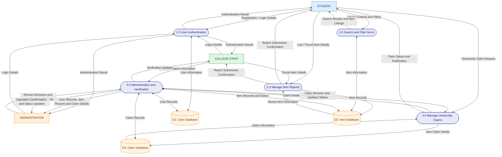

# Data Flow Diagram – Level 1
## Campus Lost and Found Management System

### 1. Introduction

The Level 1 Data Flow Diagram decomposes the main system process into five major subprocesses. It illustrates the flow of information between students, college staff, administrators, internal processes and data stores.

### 2. DFD Level 1 Diagram



### 3. Process Descriptions

**1.0 User Authentication**

Handles registration and login requests from students, college staff and administrators. User information is checked against the User Database.

**2.0 Manage Item Reports**

Receives lost and found item information, processes submissions and stores item records in the Item Database.

**3.0 Search and Filter Items**

Accepts search criteria and filters from students, retrieves matching item information and displays the results.

**4.0 Manage Ownership Claims**

Receives ownership claim requests, stores claim details and coordinates with the administration process for claim decisions.

**5.0 Administration and Verification**

Allows administrators to review users, item reports and claims. It processes verification decisions and updates relevant records and statuses.

### 4. Data Store Descriptions

| Data Store | Information Stored |
|---|---|
| D1 – User Database | User IDs, names, email addresses, roles and login information |
| D2 – Item Database | Item IDs, descriptions, categories, locations, dates and statuses |
| D3 – Claim Database | Claim IDs, user IDs, item IDs, claim details and decisions |

### 5. Conclusion

The Level 1 DFD provides a more detailed representation of the Campus Lost and Found Management System. It explains the major internal processes and their interaction with external entities and data stores.
```

### Step 3 — Visualise it

1. Open [Mermaid Live Editor](https://mermaid.live/).
2. Copy only the code inside the `mermaid` section.
3. Paste it into the left editor.
4. Check the rendered diagram on the right.
5. Export it as PNG.

Save the image as:

`DFD_Level_1.png`

inside your `diagrams/` folder.

### Step 4 — Expected folder structure

```text
diagrams/
├── README.md
├── architecture.md
├── Architecture Diagram.png
├── dfd_level_0.md
├── DFD_Level_0.png
├── dfd_level_1.md
└── DFD_Level_1.png
```

**Important:** Before pushing to GitHub, send me a screenshot of the rendered Level 1 diagram. I'll check the process flows, database connections and consistency with Level 0. Then we'll commit it and update Jira.