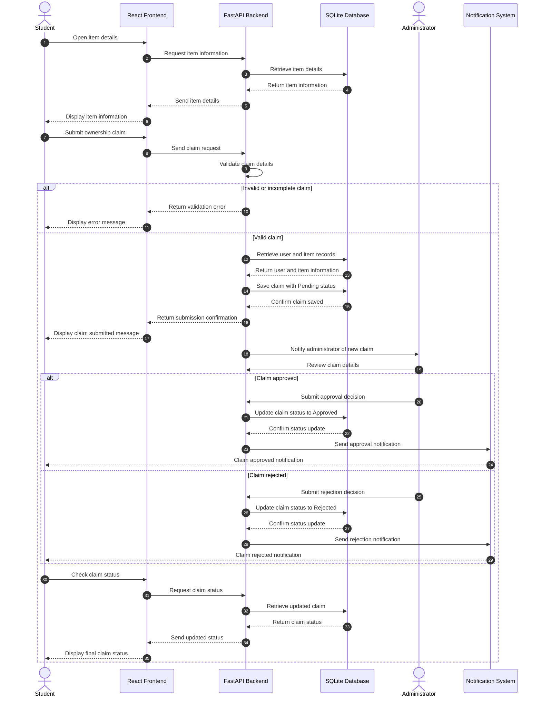

# UML Sequence Diagram
## Campus Lost and Found Management System
### Use Case: Ownership Claim Management

## 1. Introduction

The UML Sequence Diagram illustrates the interaction between the student, frontend application, backend services, database and administrator during the ownership claim process.

It represents the sequence of messages exchanged during claim submission, validation, administrative review and status notification.

# UML Sequence Diagram
## Campus Lost and Found Management System
### Use Case: Ownership Claim Management

## 3. Participant Descriptions

| Participant | Responsibility |
|---|---|
| Student | Submits an ownership claim and checks its status |
| React Frontend | Displays item details, claim forms and status information |
| FastAPI Backend | Validates requests and manages claim processing |
| SQLite Database | Stores user, item and claim information |
| Administrator | Reviews claims and submits approval or rejection decisions |
| Notification System | Communicates claim status updates to students |

## 4. Sequence Explanation

1. The student opens an item listing and views its details.
2. The student submits an ownership claim through the frontend.
3. The frontend sends the claim request to the FastAPI backend.
4. The backend validates the submitted information.
5. Invalid claims are returned with an error message.
6. Valid claims are checked against user and item records.
7. The backend stores the claim with Pending status.
8. The administrator receives and reviews the claim.
9. The administrator approves or rejects the claim.
10. The backend updates the claim status in the database.
11. The notification system communicates the decision to the student.
12. The student can view the updated claim status.

## 5. Alternate and Error Flows

### A. Invalid Claim Submission
If the submitted claim information is incomplete or invalid, the backend returns a validation error and the frontend displays an appropriate message.

### B. Approved Claim
If the administrator approves the request, the claim status is updated to Approved and the student receives an approval notification.

### C. Rejected Claim
If the administrator rejects the request, the claim status is updated to Rejected and the student receives a rejection notification.

## 6. State Transitions

The ownership claim follows these states:

- Pending: Claim submitted and awaiting administrator review.
- Approved: Administrator has accepted the ownership claim.
- Rejected: Administrator has declined the ownership claim.

The claim begins in Pending state and transitions to either Approved or Rejected after administrative review.

## 7. Conclusion

The UML Sequence Diagram describes the time-ordered interactions involved in ownership claim management. It demonstrates normal processing, validation errors, administrator decisions and claim status updates.